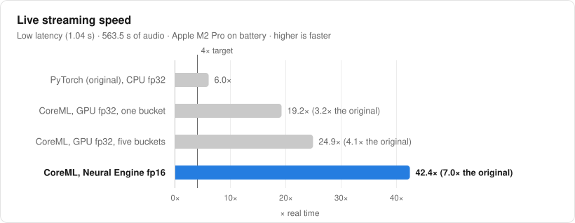
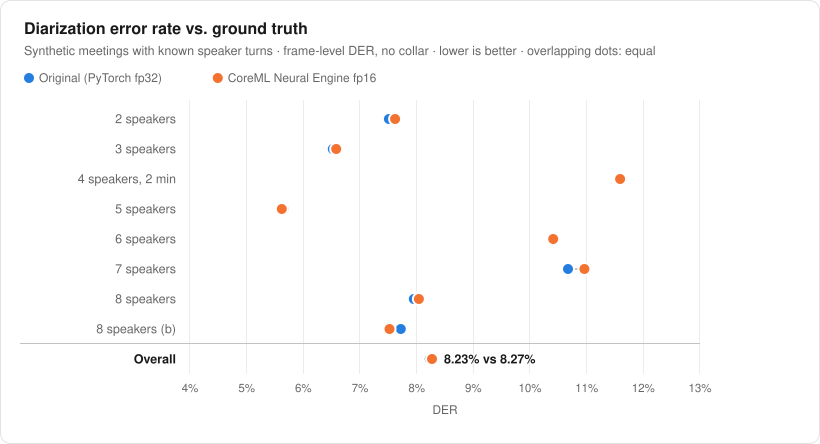
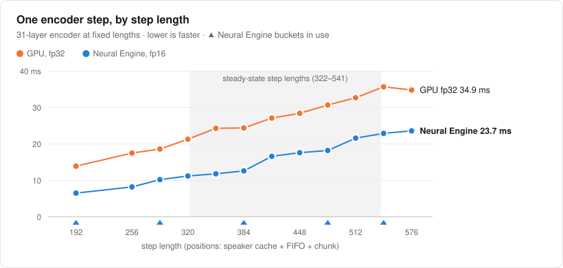
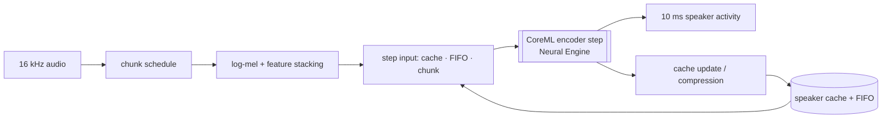

<h1 align="center">Nemotron-3-Diarization on CoreML</h1>

<p align="center">
  Streaming speaker diarization for macOS, running entirely on the Apple Neural Engine.<br>
  <b>42× real time · 7× faster than the original · same accuracy</b>
</p>

<p align="center">
  <a href="https://huggingface.co/predict-woo/Nemotron-3-Diarization-CoreML"></a>
  
  
  <a href="LICENSE"></a>
</p>

This is a CoreML conversion of [nvidia/Nemotron-3-Diarization](https://huggingface.co/nvidia/Nemotron-3-Diarization),
the streaming Sortformer that tells up to 8 speakers apart. It comes with a native Swift runtime that reproduces
the model's streaming algorithm step for step. The test framework proves each build against the original
PyTorch implementation.

<p align="center">
  <picture>
    <source media="(prefers-color-scheme: dark)" srcset="docs/img/speed-dark.svg">
    
  </picture>
</p>

## Highlights

- **Runs entirely on the Neural Engine.** CoreML places all 1,936 operations of every model function on the
  ANE. The GPU stays free, and the process uses 0.6 GB.
- **Fast.** It streams the model card's *Low latency* configuration (1.04 s latency) at 42× real time on an M2
  Pro, on battery. One 0.72 s step takes ~17 ms.
- **Accurate.** Its diarization error rate equals the original's (8.27% vs 8.23% on meetings with known
  speakers), and 99.8% of 10 ms frames get the same speakers as in the original's output.
- **Exact builds available.** fp32 GPU builds are numerically identical to the original: the same speaker cache
  at every step, the same output on every frame.
- **Truly streaming.** Push audio in blocks of any size and get speaker activity back every 0.72 s, with
  identical results to processing the whole file at once.

## Quick start

```bash
git clone https://github.com/predict-woo/nemotron-diarization-coreml && cd nemotron-diarization-coreml
hf download predict-woo/Nemotron-3-Diarization-CoreML --include "Nemotron3Diarization/*" --local-dir models
swift build -c release
.build/release/nemotron-diarize --bundle models/Nemotron3Diarization --segments two_speakers.wav
```

```
model loaded in 0.84s (low_latency)
file                                    audio_s   proc_s    RTFx  steps  step_ms mean/p50/p95/max
two_speakers                               60.0     1.16    51.7     83  14.0/13.0/23.5/23.7
  speaker_0      0.11 -    34.11
  speaker_1     34.84 -    42.36
  speaker_0     42.48 -    60.00
overall RTFx 51.7 (60.0s audio in 1.16s)
```

[`two_speakers.wav`](https://huggingface.co/datasets/hf-internal-testing/dummy-audio-samples) is one of the test
recordings. Short files run faster than the steady-state 42×, because the speaker cache is still filling up.
Neural Engine output is deterministic for a given compiled model. Separate compilations can differ by fp16
noise, enough to move a segment boundary that sits at exactly 50% probability by one 10 ms frame.

* **First launch.** It takes about 75 s on a new machine while the Neural Engine compiler builds the model.
  macOS caches the result, and later launches take about 0.5 s.
* **Audio input.** Any format AVFoundation reads; it's converted to 16 kHz mono.
* **Build error with Xcode 26.** If the build fails with `unknown architecture` in a `.tbd` file, the Command
  Line Tools SDK is newer than Xcode's linker. Run
  `export SDKROOT=$(xcode-select -p)/Platforms/MacOSX.platform/Developer/SDKs/MacOSX.sdk` first.

### From Swift

Add the package (`https://github.com/predict-woo/nemotron-diarization-coreml`) and use `NemotronDiarization`:

```swift
import NemotronDiarization

let diarizer = try StreamingDiarizer(bundleURL: modelURL, mode: .lowLatency)
try diarizer.warmUp()
for block in microphoneBlocks {                       // 16 kHz mono Float32, any block size
    let out = try diarizer.push(block)                // completed chunks, if any
    handle(out.probabilities, frames: out.numFrames)  // numFrames × 8, one row per 10 ms
}
let tail = try diarizer.finish()                      // the last frames of the stream
```

Speakers are numbered in order of first appearance. For whole recordings, `OfflineDiarizer(bundleURL:)` gives the
same results as streaming them.

## Models

Prebuilt bundles are on [Hugging Face](https://huggingface.co/predict-woo/Nemotron-3-Diarization-CoreML). The numbers
below are on an M2 Pro on battery, Low latency mode, over 563.5 s of audio.

| Bundle | Runs on | Live speed | vs original | Memory | Accuracy |
| --- | --- | --- | --- | --- | --- |
| **`Nemotron3Diarization`** | **Neural Engine, fp16** | **42.4×** | **7.0×** | **0.6 GB** | same DER as the original |
| `Nemotron3Diarization-gpu` | GPU, fp32 | 24.9× | 4.1× | 2.4 GB | identical |
| `Nemotron3Diarization-gpu-compact` | GPU, fp32 | 19.2× | 3.2× | 0.8 GB | identical |
| PyTorch (the original) | CPU, fp32 | 6.0× | 1.0× | — | reference |

* **Memory** is peak resident memory, including the memory-mapped weights.
* **Other streaming modes:** the Neural Engine bundle also runs the model card's *Very low latency* (0.64 s) and
  *Ultra-low latency* (0.32 s) modes, at 32.6× and 16.6× real time.
* **Whole files:** `--offline` runs independent steps concurrently, which brings the GPU bundle to 32.1×.

## Accuracy

fp16 can't reproduce fp32 bit for bit, so the Neural Engine build is judged on how well it diarizes. The test
set is 8 synthetic meetings (2–8 speakers) with ground-truth speaker turns, plus 12 real recordings.

<p align="center">
  <picture>
    <source media="(prefers-color-scheme: dark)" srcset="docs/img/accuracy-dark.svg">
    
  </picture>
</p>

| | Original (PyTorch fp32) | GPU fp32 build | Neural Engine build |
| --- | --- | --- | --- |
| DER vs ground truth (8 meetings) | 8.23% | 8.23% | 8.27% |
| 10 ms frames whose speakers differ from the original (20 recordings) | — | 0 | 0.22% |

Most of that 0.22% comes from the ~4% of steps that compress the speaker cache. There, fp16 sometimes keeps
different (equally good) frames than fp32 would. The speaker cache is inherently this sensitive: even the
original's own fp32 and fp64 runs disagree on one recording. Details are in [docs/findings.md](docs/findings.md#neural-engine).

## How it's fast

Every streaming step re-encodes the whole context: speaker cache, FIFO and new chunk, 13 to 541 frames of
80 ms, through 31 Transformer layers. The work is organized around that:

<p align="center">
  <picture>
    <source media="(prefers-color-scheme: dark)" srcset="docs/img/latency-dark.svg">
    
  </picture>
</p>

- **The Neural Engine version follows** [apple/ml-ane-transformers](https://github.com/apple/ml-ane-transformers):
  channels-first tensors, 1×1 convolutions and per-head attention. LayerNorm inputs are pre-scaled, because the
  residual stream reaches values that would overflow fp16.
- **Length buckets:** each step runs the smallest fixed-length model function that holds it, padded and masked.
  Bucket lengths sit at the ends of the Neural Engine's cost plateaus (▲). On the ANE, extra buckets cost almost
  no memory; on the GPU, each one costs a 400 MB weight copy.
- **The host side** (Swift, fp32) computes the log-mel features and runs the speaker cache. It follows the
  original line for line, down to the tie-breaking of PyTorch's top-k and the order in which scores are summed.



What worked, what didn't, and why is in **[docs/findings.md](docs/findings.md)**.

## Verification

`pytest` streams the same recordings through the original and through each port.

| Check | Holds |
| --- | --- |
| Front end, speaker cache, top-k, export graph vs the original's modules | unit tests |
| Host pipeline + original encoder, CoreML pipeline in Python, Swift runtime (GPU fp32): live, whole-file and all three latency modes | **identical** to the original: same cache contents at every step, same speakers on every frame, probabilities within 1e-4 |
| Swift runtime, Neural Engine bundle | every op on the ANE; DER within 0.25 points of the original; at most 0.5% of frames differ |
| Speed | ≥ 4× real time |

The suite has 105 tests: run `pytest` for a quick subset, or `pytest --full` for every recording.

## Reproduce

<details>
<summary>Convert the model, build the bundles, regenerate the test data and goldens</summary>

Requires Xcode 26, [uv](https://github.com/astral-sh/uv), ffmpeg and the `hf` CLI.

```bash
uv venv --python 3.13 .venv && source .venv/bin/activate && uv pip install -e .
hf download nvidia/Nemotron-3-Diarization --local-dir hf/Nemotron-3-Diarization
clang++ -O2 -std=c++17 -shared -fPIC native/torch_topk.cpp -o native/libtorch_topk.dylib
python scripts/export_constants.py

# test data: HF dummy audio samples (16 kHz mono) + synthetic meetings with ground-truth labels
scripts/fetch_test_audio.sh && python scripts/make_test_audio.py --stress

# golden runs of the original (the repository ships them in golden/)
python scripts/make_golden.py

# convert and bundle
python scripts/convert_ane.py --buckets 192,288,384,480,544 --out build/encoder_ane.mlpackage
python scripts/build_bundle.py --model build/encoder_ane.mlpackage --out dist/Nemotron3Diarization
python scripts/convert.py --out build/encoder_fp32_buckets.mlpackage
python scripts/build_bundle.py --model build/encoder_fp32_buckets.mlpackage --out dist/Nemotron3Diarization-gpu
python scripts/convert.py --buckets 576 --out build/encoder_fp32_576.mlpackage
python scripts/build_bundle.py --model build/encoder_fp32_576.mlpackage --out dist/Nemotron3Diarization-gpu-compact

# verify and measure
swift build -c release && pytest --full
.build/release/nemotron-diarize --bundle dist/Nemotron3Diarization --out runs/ane data/16k/*.wav
python scripts/der_report.py runs/ane
python scripts/bench_original.py obama stress_12_5spk_300s two_speakers
python scripts/make_charts.py
```

The NeMo reference (`scripts/nemo_reference.py`) needs NeMo Speech from GitHub main in a separate environment.
</details>

## Repository

```
Package.swift, swift/     Swift package: NemotronDiarization (StreamingDiarizer, OfflineDiarizer) + nemotron-diarize CLI
nemodiar/                 Python: the original's reference runner, NumPy port of the pipeline, CoreML conversion
                          graphs (GPU, Neural Engine), comparison and DER tools
native/torch_topk.cpp     PyTorch's CPU top-k, shared with the Swift runtime
scripts/                  conversion, bundling, goldens, evaluation, benchmarks, charts
tests/                    unit, identity and Neural Engine tests
golden/                   runs of the original that the tests compare against
experiments/, docs/       the measurements behind the design, and what they showed
```

## License

* **The code** is released under [Apache-2.0](LICENSE).
* **The model weights,** and the CoreML models derived from them, come from NVIDIA under the
  [OpenMDW License 1.1](https://openmdw.ai/license/1-1/).
* **Credits:** the modeling follows Hugging Face Transformers' implementation; see [NOTICE](NOTICE).
